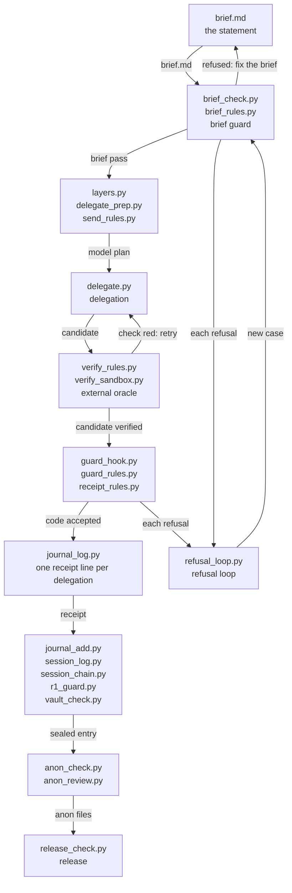

# How a task flows through FrugalFlow

A task enters FrugalFlow as a written brief in a Markdown file and leaves it as a published release; every step between those two points is carried out by a small tool, and each tool refuses by default, prints the refusal reason, and says how to fix it. All tools live in `public/bin/`.

## The path

## Reading the path

### A — brief.md

`brief.md` is the written statement of the task, a Markdown file. It is the only input the pipeline accepts as a starting point; nothing runs until a brief exists.

### B — brief_check.py and brief_rules.py

`brief_check.py` reads the brief and applies the rules held in `brief_rules.py`; for every rule that fails it prints the fix and exits with a non-zero code. A refused brief returns to its author through `refusal_loop.py` before any delegation is attempted.

### C — layers.py, delegate_prep.py, send_rules.py

`layers.py` checks the delegation layers and roles declared in `models.json` and says which model fulfils a role under a trust ceiling, while `delegate_prep.py` turns that role into a checked model plan or a refusal with its code. `send_rules.py` then decides what content may actually leave toward the chosen model: it allows the text, replaces personal data with labels, or blocks the send entirely when a secret is detected.

### D — delegate.py

`delegate.py` sends the task to the role's model and writes the result into the target file, replacing it only with a verified candidate. When invoked with `--verify` it retries the whole send until the external check passes.

### E — verify_rules.py and verify_sandbox.py

`verify_rules.py` judges the check command before execution, accepting it, rewriting it to run on the candidate, or refusing it outright. `verify_sandbox.py` then runs the check in a temporary folder containing only the useful files, with no sensitive variables and a time limit, returning the exit status and a report of any write that reached the project.

### F — guard_hook.py, guard_rules.py, receipt_rules.py

`guard_hook.py` is the PreToolUse hook: every tool call passes through it before execution, and its decision is logged together with the refusal text. `guard_rules.py` decides allow or deny from the recent receipts, and `receipt_rules.py` answers whether a code file on disk comes from a recent successful delegation.

### G — journal_log.py

`journal_log.py` writes exactly one line in the delegation log for each completed delegation and can sum a log up for reporting. That single receipt line becomes the provenance record consulted by `guard_rules.py` and `receipt_rules.py` on every subsequent tool call.

### H — journal_add.py, session_log.py, session_chain.py, r1_guard.py, vault_check.py

`journal_add.py` appends one sealed entry to a vault's append-only log after checking the chain, while `session_log.py` writes one sealed line per hook event and `session_chain.py` seals each line with the sha256 of the previous one, verifying the chain against its anchor. `r1_guard.py` blocks the end of a turn whenever a state-changing command ran without a vault entry after it, and `vault_check.py` performs the hard closing pass confirming that everything written in the vault is true.

### I — anon_check.py and anon_review.py

`anon_check.py` refuses any file that carries a private name, a personal path, an address, or a secret, emitting one refusal per finding or a clean pass. `anon_review.py` asks the local model to reread each file in one fresh call per file and reports suspicions; it proposes but never guards.

### J — release_check.py

`release_check.py` stages the publish tree into the output folder and runs the last checks before the repository is made public. It returns the staged tree and a `READY` or `NOT READY` verdict.

### K — refusal_loop.py

`refusal_loop.py` turns every new refusal from `brief_check.py` or `guard_hook.py` into a todo line and blocks a commit while a tool logs no refusal, the bench holds a false refusal, or the bench contains a hole. It feeds a new case back to `brief_check.py` so that each failure becomes a permanent bench entry.

## Tool table

| Tool | Role | Input | Output |
|---|---|---|---|
| `brief_check.py` | checks a delegation brief against the rules file before it is sent | a brief file, config/brief_rules.json | for each refused rule how to fix the brief, exit code |
| `brief_rules.py` | pure module: applies the brief rules | brief text, rules | the refused rules, each with its fix |
| `layers.py` | checks the delegation layers and roles, says which model does a role under a trust ceiling | the layers and roles of models.json | the model for a role, or a refusal |
| `config_check.py` | refuses a configuration that breaks the contract and shows where each ceiling came from | the three JSON settings files | a verdict and the source of each ceiling |
| `delegate_prep.py` | turns a role into a checked model plan | a role name | a model plan, or a refusal with its code |
| `send_rules.py` | decides what may leave for a model | the content and the trust level of the destination | allow, labels instead of personal data, or nothing when a secret is found |
| `delegate.py` | sends the task to the role's model; with --verify retries until the check passes | a brief, a role, a target file, a check command | the target file, replaced only by a verified candidate |
| `verify_rules.py` | judges the check command before sending | a check command | accepted, or rewritten to run on the candidate, or refused |
| `verify_sandbox.py` | runs the check in a temporary folder with only the useful files, without sensitive variables, under a time limit | a candidate and a check command | the check's exit status and a report of any write into the project |
| `guard_hook.py` | the PreToolUse hook of Claude Code | a tool call | the decision, logged, with the refusal text |
| `guard_rules.py` | decides whether a tool call passes | a tool call and the recent receipts | allow or deny |
| `shell_rules.py` | decides whether a shell command passes | a shell command | allow or deny |
| `receipt_rules.py` | says whether a code file comes from a recent successful delegation | a code file and the receipts | yes or no |
| `journal_log.py` | writes one log line per delegation and sums a log up | a delegation result | one line in the delegation log |
| `journal_add.py` | appends one sealed entry to a vault's append-only log after checking the chain | entry fields | one sealed entry in the vault log |
| `session_log.py` | the Claude Code hook that writes every session event | hook events | one sealed line per event in the session log |
| `session_chain.py` | seals each line with the sha256 of the previous one and verifies the chain | a session log | the chain verdict and the comparison with its anchor |
| `r1_guard.py` | the end-of-turn hook | the session log | blocks the end of a turn while a state-changing command ran with no vault entry after it |
| `vault_new.py` | mounts a new project's memory vault | a project name | folders, rules, todo, sealed log, index and sources |
| `vault_check.py` | the vault's hard closing pass | a vault | a verdict on the invariants its rules encode (not on truth) |
| `reading_gate.py` | the vault's reading gate | required pages and a restatement | an attestation only when the restatement repeats every bearing line |
| `session_digest.py` | the closing pass of the session log | a session log | a readable digest, health checks, an exit code |
| `refusal_loop.py` | turns new refusals into todo lines and blocks a commit while a tool logs no refusal or the bench has a false refusal or a hole | refusal logs and the project bench | todo lines, a commit verdict |
| `anon_check.py` | refuses files that carry a private name, a personal path, an address or a secret | files | a refusal per finding, or a pass |
| `anon_review.py` | has the local model reread each file, one fresh call per file | files | a report of suspicions; it proposes, it never guards |
| `release_check.py` | stages the publish tree and runs the last checks | the repository, an output folder | the staged tree and a READY or NOT READY verdict |
| `frugalflow.py` | the product entry point | a subcommand (init, doctor, new-project, mode...) | an installed, checked, or mounted project |

## Where each step is tested

Every tool in `public/bin/` answers `--notice` and `--autotest`, and the end-to-end suites live in `public/tests/e2e_*.py`.
